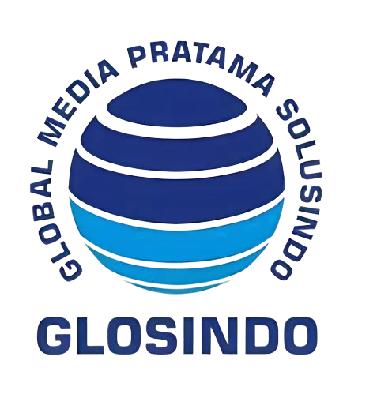

# 🌐 GLOSINDO - GLIDE Digital Guestbook System (Frontend)

**PT Global Media Pratama Solusindo**

Aplikasi frontend modern untuk sistem buku tamu digital mandiri (*kiosk self check-in*) dan manajemen pengunjung cerdas terintegrasi menggunakan **React 18**, **Vite**, **Tailwind CSS**, dan **face-api.js**.

---

## 🚀 Quick Start

```bash
# Install dependensi
npm install

# Jalankan server lokal
npm run dev

# Kompilasi bundle produksi
npm run build

# Pratinjau build produksi
npm run preview
```

---

## 🎨 Identitas Brand

### Logo Resmi


### Palet Warna
- **Navy Blue**: `#1e3a8a` (`bg-brand-navy`, `text-brand-navy`)
- **Cyan Blue**: `#0ea5e9` (`bg-brand-cyan`, `text-brand-cyan`)

---

## 🔑 Fitur Frontend Utama

- 📸 **Kiosk Mandiri Biometrik (GLIDE Guestbook):** Identifikasi wajah instan, opsi keperluan cepat, form pengunjung baru/lama.
- 🌐 **Portal Registrasi Publik Mandiri:** Formulir registrasi tamu online via browser/smartphone sebelum datang ke lokasi.
- 🎪 **Portal Acara & Game Scan Points:** Halaman pendaftaran acara publik serta scan QR perolehan poin pengunjung.
- 🏢 **Panel Resepsionis Khusus:** Antarmuka ringkas resepsionis untuk verifikasi cepat tamu masuk & keluar.
- 📊 **Dashboard Analitik & Tamu Aktif:** Visualisasi grafik kunjungan, status tamu real-time di gedung, dan riwayat kunjungan.
- 📑 **Export Laporan:** Integrasi unduh laporan PDF & Excel.
- 📱 **Capacitor Android:** Dukungan runtime aplikasi mobile Android.

---

## 🗺️ Panduan Rute Lengkap

| Rute | Halaman / Modul | Akses |
|------|-----------------|-------|
| `/guest-visit` / `/kunjungan-tamu` | Kiosk Mandiri Wajah (GLIDE Guestbook) | Publik (Kiosk) |
| `/register` / `/registrasi-tamu` | Pendaftaran Tamu Mandiri Publik | Publik |
| `/event/:code/register` | Pendaftaran Acara Publik | Publik |
| `/games/register/:token` | Registrasi Peserta Gamification | Publik |
| `/games/scan-point` | Pemindai Poin Gamification Event | Publik |
| `/login` | Masuk Petugas / Admin | Publik |
| `/dashboard` | Dashboard Analitik & Statistik | Admin, Receptionist |
| `/check-in` | Pemindai Kamera Petugas | Admin, Receptionist |
| `/check-in/manual` | Formulir Check-In Manual Petugas | Admin, Receptionist |
| `/active-visitors` | Daftar Tamu yang Sedang Aktif | Admin, Receptionist |
| `/visit-history` | Riwayat Kunjungan & Ekspor Data | Admin, Receptionist |
| `/visitors` | Direktori Master Data Tamu | Admin, Receptionist |
| `/events` | Manajemen Event & Daftar Peserta | Admin |
| `/games/events` | Manajemen Event Gamification | Admin |
| `/users` | Kelola Petugas & Toggle Akses Fitur | Admin Only |
| `/settings` | Pengaturan Sistem & Portal Tamu | Admin Only |

---

## 🛠️ Tech Stack & Library

- **Core:** React 18 + Vite
- **Styling:** Tailwind CSS
- **AI Face Recognition:** `face-api.js` (SSD Mobilenet v1, Face Landmark 68, Face Recognition)
- **State Store:** Zustand (`authStore.js`)
- **Routing:** React Router v6
- **Charts:** Recharts
- **Icons:** Lucide React
- **Toast Notifications:** React Hot Toast
- **Mobile Packaging:** Capacitor Android (`@capacitor/core`, `@capacitor/android`)

---

## 🔐 Konfigurasi Environment

Buat file `.env` di direktori `glosindo-frontend`:

```env
VITE_API_URL=http://localhost:8000/api
```

---

## 📁 Struktur Folder

```text
src/
├── assets/          # Logo Glosindo, ilustrasi, media
├── components/      # Komponen UI (Navbar, Sidebar, FaceScanner, Button, Card, Badge)
├── constants/       # Konstanta brand (LOGO, APP_NAME, APP_FULL_NAME)
├── hooks/           # Custom React hooks (useFaceModels, useFaceMatcher, dsb)
├── pages/           # Halaman rute aplikasi
│   ├── admin/       # Halaman kelola admin
│   ├── events/      # Halaman modul acara
│   ├── games/       # Halaman modul gamification
│   └── receptionist/# Halaman panel resepsionis
├── services/        # Klien API Axios (auth, visitors, events, public registration)
├── store/           # Zustand state store
└── utils/           # Helper fungsi tanggal, validasi, dan face descriptor
```

---

## 📝 Lisensi

© 2026 **PT Global Media Pratama Solusindo (GLOSINDO)**. All rights reserved.
